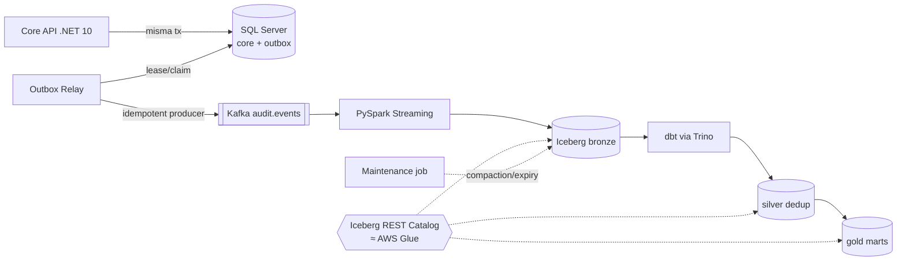

# Audit Offloading Lakehouse — PoC

> Prueba técnica makers · Desarrollador .NET con énfasis en datos
> .NET 10 · SQL Server · Kafka · PySpark · Apache Iceberg · dbt · Trino · 100% gratuito y local

**Problema:** las tablas de auditoría e hiper-logs del core transaccional crecen sin control, degradan el
OLTP y elevan costos.
**Solución:** desacoplar el registro de eventos del core (Transactional Outbox → Kafka) y llevarlos a un
Lakehouse en Iceberg con ciclo de vida hot/warm/cold, calidad garantizada con dbt y cero pérdida
verificable.

<!-- TODO paso 13: diagrama mermaid -->


---

## 1. Quick start
**Prerrequisitos:** Docker Desktop / Engine con ≥ 8 GB de RAM asignados, `make`, `git`.
(Apple Silicon: SQL Server corre emulado; activa Rosetta en Docker Desktop.)

```bash
git clone <repo> && cd <repo>
cp .env.example .env
make up      # levanta infraestructura y servicios
make demo    # flujo end-to-end: carga → outbox → kafka → iceberg → dbt → gold
```
<!-- TODO: puertos, qué ver en cada paso, tiempos aproximados -->

Cada target de `make` solo llama a `docker compose ...` o a `bash scripts/<x>.sh`, así que todo se
puede correr sin `make` (por ejemplo, en Windows sin make instalado) con el comando equivalente:

| Comando | Sin make | Qué hace / demuestra |
|---|---|---|
| `make help` | `bash scripts/help.sh` | Lista los targets |
| `make up` | `docker compose up -d --wait` | Levanta todo y espera a que esté healthy (requiere `.env`) |
| `make down` | `docker compose down` | Detiene los servicios, conserva los volúmenes |
| `make clean` | `docker compose down -v` | Detiene y **borra los volúmenes** (todos los datos locales) |
| `make demo` | _(paso 06)_ | Flujo end-to-end |
| `make chaos` | _(paso 10)_ | Cero pérdida con caída de ingesta y de Kafka |
| `make replay FROM=...` | _(paso 10)_ | Replay desde Kafka / outbox |
| `make maintenance` | _(paso 07)_ | Small files: antes/después de la compactación |
| `make evolve` | _(paso 08)_ | Evolución de esquema v1→v2 + time travel |
| `make lifecycle` | _(paso 09)_ | Backfill verificado + purga segura en SQL Server |
| `make metrics` | _(paso 12)_ | Números para el análisis costo-beneficio |

## 2. Servicios
<!-- TODO: tabla servicio / imagen:tag / puerto / rol -->

## 3. Decisiones de arquitectura
Resumen; el detalle con alternativas descartadas está en [docs/decisions.md](docs/decisions.md).
<!-- TODO: 1 línea por ADR -->

## 4. Respuestas a las preguntas estructurales

### 4.1 Impacto relacional vs. analytics
*¿Por qué mantener logs en SQL Server es un anti-patrón a escala y cuál es la métrica costo-beneficio de
llevarlo a Iceberg?*

<!-- BORRADOR: reescribe en tus palabras y completa con docs/metrics.md -->
Un log de auditoría es *append-only*, crece sin límite y se lee poco, casi siempre en escaneos
analíticos. SQL Server está optimizado para lo contrario: lecturas y escrituras puntuales
transaccionales. Mantenerlo ahí:
- **Compite por recursos con el negocio:** las páginas de log ocupan buffer pool, aumentan el I/O, el
  tamaño del transaction log y la ventana de backups.
- **Multiplica el costo de almacenamiento:** el mismo GB se paga en disco premium × réplicas de alta
  disponibilidad × backups, y con licencias por core dimensionadas para OLTP.
- **Hace caro borrar:** las purgas masivas escalan locks e inflan el log; el mantenimiento de índices
  crece con la tabla.
- **Es mala plataforma analítica:** el almacenamiento es por filas, sin columnar ni separación
  cómputo/almacenamiento.

En Iceberg sobre S3, el dato va en Parquet+zstd columnar, en object storage barato, con el cómputo
separado (se paga por consulta) y con evolución de esquema y time travel.

**Métrica propuesta:** *costo efectivo por GB-mes retenido* y *latencia p95 del OLTP*.
`costo_SQL = GB × (precio_disco_premium × factor_HA + precio_backup)` vs
`costo_lake = (GB / ratio_compresión) × precio_S3 + costo_consulta`.
Medido en el PoC: <!-- TODO: bytes/fila SQL vs Iceberg, ratio, p95 antes/después (docs/metrics.md) -->

### 4.2 Criterio de herramientas
*¿Qué responsabilidad exacta le asignas a PySpark vs. dbt y por qué Glue/Catalog facilita la gobernanza
sin rehacer el modelo?*

<!-- BORRADOR -->
- **PySpark mueve bytes con garantías:** streaming Kafka→bronze, backfill JDBC desde SQL Server y
  mantenimiento de tablas (compactación, expiración de snapshots, huérfanos). Es imperativo, pesado
  en I/O y necesita control de offsets y checkpoints.
- **dbt define la semántica de negocio:** dedupe (silver con merge por `event_id`), modelos gold,
  **tests como contrato de calidad** (unicidad, nulos, cero pérdida contra el outbox), linaje y
  documentación. Es declarativo, SQL versionado y revisable por analistas.
- **El catálogo solo guarda el puntero:** esquema, particiones y snapshots viven en los metadatos de
  Iceberg. Pasar del REST catalog local a Glue cambia **una línea de configuración** y deja intactos las
  tablas, los jobs y los modelos dbt. Glue agrega encima descubrimiento, Lake Formation (permisos por
  columna y fila, por ejemplo para enmascarar PII de auditoría) y compactación administrada.

### 4.3 Resiliencia y consistencia
*Si el servicio de ingestión cae durante un pico de carga, ¿cómo se garantiza cero pérdida y cuál es el
mecanismo de replay?*

<!-- BORRADOR -->
La garantía se defiende por capas, y en cada una el dato ya está persistido antes de pasar a la
siguiente:
1. **En el origen:** el evento se escribe en el outbox en la **misma transacción** que el negocio. Si
   la transacción hace commit, el evento existe. La API no depende de Kafka ni de Spark.
2. **Si cae el relay o Kafka:** el outbox crece y el relay reintenta con backoff. Una lease vencida se
   reclama de nuevo, sin locks largos sobre el OLTP.
3. **Si cae Spark durante el pico:** Kafka retiene 7 días y Structured Streaming retoma desde el
   checkpoint. Iceberg confirma los snapshots de forma atómica, así que no quedan micro-batches a medias.
4. **Dedupe:** la entrega es at-least-once; silver hace merge por `event_id`.
5. **Verificación:** el test dbt `assert_no_event_loss` compara el outbox despachado contra silver.

**Replay:** (a) desde Kafka, con un job one-off con `startingOffsetsByTimestamp` y un checkpoint nuevo
(los offsets viven en el checkpoint, no en el consumer group); (b) desde el outbox, cuando el
incidente supera la retención de Kafka, marcando `ProcessedAt = NULL` por rango. Ambos son seguros
porque silver es idempotente.
Demostrado en `make chaos`: <!-- TODO: resultados -->

### 4.4 Control del output de IA
<!-- TODO: elegir la mejor entrada de docs/ai-log.md, idealmente una técnica de implementación -->

## 5. Uso de IA
<!-- TODO: resumen de docs/ai-log.md: herramientas, prompts clave, correcciones, métricas -->

## 6. Limitaciones del PoC y camino a producción en AWS
<!-- TODO: Spark local → EMR Serverless/Glue jobs; Kafka → MSK; REST → Glue Catalog; Trino → Athena;
SeaweedFS → S3; secretos → Secrets Manager; Lake Formation; observabilidad; Object Lock -->
- **Dead-letter del outbox.** En el PoC, una fila que llega a `Attempts >= 10` solo genera un log
  `Warning` con su `EventId` y `LastError` (candidata a dead-letter) y se queda en la cola. En
  producción se movería a una tabla `outbox.DeadLetter` o a un topic `audit.events.dlq`, con una
  alarma y un procedimiento de re-drive, para que un mensaje envenenado no se reintente para siempre.
