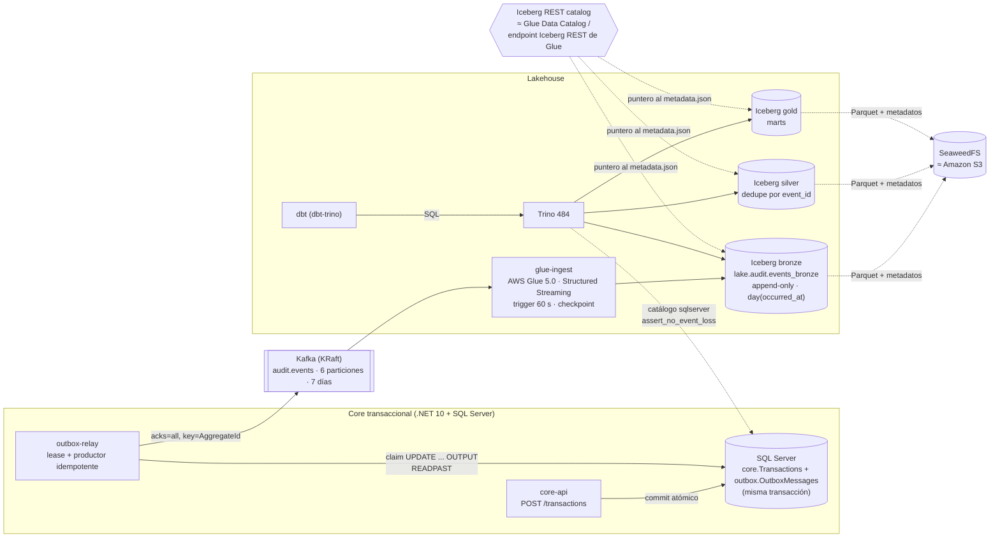

# Audit Offloading Lakehouse — PoC

> Prueba técnica makers · Desarrollador .NET con énfasis en datos
> .NET 10 · SQL Server · Kafka · AWS Glue 5.0 (PySpark) · Apache Iceberg · dbt · Trino · 100% gratuito y local

## Resumen
**Problema:** las tablas de auditoría del core transaccional crecen sin control dentro de SQL Server,
compiten con el negocio y encarecen el almacenamiento.
**Solución:** escribo el evento de auditoría en un *Transactional Outbox* dentro de la misma transacción
del negocio, un relay lo publica a Kafka y un job de AWS Glue 5.0 lo ingiere en Iceberg. dbt (vía Trino)
deduplica, modela y prueba el resultado, incluido un test de cero pérdida contra el outbox.
**Resultado medido:** el mismo evento ocupa **1.089,5 B/fila en `outbox.OutboxMessages`** frente a
**93,7 B/fila en Iceberg bronze** (Parquet + zstd), y `make demo` concilia **1000 = 1000** en las seis
capas (SQL Server, outbox, Kafka, bronze, bronze distinto, silver) desde un entorno vacío.



---

## 1. Quick start
**Prerrequisitos**
- Docker Desktop / Engine con **≥ 8 GB de RAM** asignados (los `mem_limit` suman ~6 GB: SQL Server 2 GB,
  Glue 2 GB, Trino 1,5 GB, Kafka con heap de 512 MB).
- **Primer arranque lento:** la imagen oficial de AWS Glue 5.0 (`public.ecr.aws/glue/aws-glue-libs:5`,
  pinneada por digest) pesa **~12 GB**. El pull es anónimo desde ECR Public (sin cuenta AWS) y solo ocurre
  la primera vez.
- `git` y, opcionalmente, `make`. Todo target tiene un equivalente sin make (tabla de abajo).
- **Windows:** usa Git Bash. El repo fuerza finales de línea LF con `.gitattributes` (un CRLF rompe los
  scripts dentro de los contenedores), y los scripts exportan `MSYS_NO_PATHCONV=1` para que Git Bash no
  reescriba rutas como `/opt/...`. Git Bash no trae `make`: usa los comandos de la columna "Sin make".
- Apple Silicon: SQL Server es solo amd64 y corre emulado; activa Rosetta en Docker Desktop.

```bash
git clone <repo> && cd <repo>
cp .env.example .env     # valores dummy, solo locales
make up                  # docker compose up -d --build --wait
make demo                # bash scripts/e2e_demo.sh
```

`make demo` carga 1000 transacciones, espera por Trino a que bronze tenga todo lo que el outbox despachó
(timeout de 3 min; con el trigger de 60 s tardó entre 51 y 88 s en mis corridas), corre
`dbt source freshness` + `dbt build` e imprime la conciliación. Salida real de la corrida desde cero
(`make clean && make up && make demo`):

```
==> 5/5 Summary
              layer               | events
----------------------------------+--------
 SQL Server core.transactions     |   1000
 Outbox dispatched                |   1000
 Kafka audit.events (end offsets) |   1000
 Bronze rows                      |   1000
 Bronze distinct event_id         |   1000
 Silver (deduplicated)            |   1000
```
Antes de eso imprime `Done. PASS=16 WARN=0 ERROR=0 SKIP=0` de dbt, y después el top 5 de cada tabla gold.

**Dónde mirar:** API en `http://localhost:8081`, UI de Trino en `http://localhost:8080`, catálogo
Iceberg en `http://localhost:8181/v1/namespaces/audit/tables`, CLI SQL con `docker compose exec trino trino`
(catálogos `lake` y `sqlserver`).

| Comando | Sin make | Qué hace / demuestra |
|---|---|---|
| `make help` | `bash scripts/help.sh` | Lista los targets |
| `make up` | `docker compose up -d --build --wait` | Construye, levanta todo y espera a que esté healthy (requiere `.env`) |
| `make down` | `docker compose down` | Detiene los servicios, conserva los volúmenes |
| `make clean` | `docker compose down -v` | Detiene y **borra los volúmenes** (todos los datos locales) |
| `make demo` | `bash scripts/e2e_demo.sh` | **Flujo end-to-end** con conciliación por capa y top 5 de gold |
| `make load N=5000 P=20` | `docker compose run --rm loadgen --count 5000 --parallel 20` | N `POST /transactions` con paralelismo P (defaults N=1000, P=10); imprime códigos HTTP, req/s y p50/p95/p99. Sale ≠0 si hubo algún 5xx |
| `make dbt` | `docker compose run --rm dbt build` | staging/silver/gold + tests de calidad (incluye `assert_no_event_loss`) |
| `make docs` | `docker compose run --rm dbt docs generate` | Documentación y linaje dbt en `lakehouse/dbt/target/` |
| `make test` | `bash scripts/test.sh` | `dotnet test` en la imagen SDK pinneada (sin SDK local). Con el stack arriba incluye el test de atomicidad contra SQL Server real; sin él ese test sale **skipped**. Cache NuGet en el volumen `audit-lakehouse_nuget-cache` (no lo borra `make clean`) |
| _(sin target)_ | `docker compose run --rm --no-deps glue-jobs spark-submit tests/test_ingest_audit_stream.py` | Tests de las funciones puras PySpark (fidelidad del payload, linaje, DDL) |
| _(sin target)_ | `docker compose run --rm glue-jobs spark-submit jobs/create_tables.py --JOB_NAME create_tables` | Job Glue que crea `lake.audit.events_bronze` (idempotente; `glue-ingest` también lo invoca al arrancar) |
| _(sin target)_ | `docker compose run --rm glue-jobs spark-sql -e "select count(*) from lake.audit.events_bronze"` | SQL sobre el lakehouse con el motor Glue/Spark |

Mantenimiento de tablas, evolución de esquema, ciclo de vida, caos/replay, hiper-logs y métricas
automatizadas **no tienen target**: quedaron como diseño (sección 7).

## 2. Servicios
| Servicio | Imagen:tag | Puerto host | Rol |
|---|---|---|---|
| `sqlserver` | `mcr.microsoft.com/mssql/server:2022-CU28-ubuntu-22.04` (Developer) | 1433 | Core OLTP + outbox |
| `sqlserver-init` | misma imagen | — | One-shot: `infra/sqlserver/init.sql` idempotente (schemas, índices, cuentas, 200.000 filas legadas en `audit.AuditLog`) |
| `kafka` | `apache/kafka:4.3.2` (KRaft, 1 nodo) | 29092 | Buffer durable + ventana de replay |
| `kafka-init` | `apache/kafka:4.3.2` | — | One-shot: crea `audit.events` (6 particiones, 7 días) y `app.logs` (3 días) |
| `seaweedfs` | `chrislusf/seaweedfs:4.55` | 8333 | Object storage S3-compatible (≈ S3) |
| `storage-init` | `amazon/aws-cli:2.42.4` | — | One-shot: crea el bucket `warehouse` |
| `iceberg-rest` | `apache/iceberg-rest-fixture:1.8.1` (JDBC sqlite en volumen) | 8181 | Catálogo Iceberg REST (≈ Glue Data Catalog) |
| `core-api` | build `src/dotnet` (target `api`, base `aspnet:10.0.15-noble-chiseled-extra`) | 8081 | API transaccional, escribe negocio + outbox |
| `outbox-relay` | misma imagen, `Role=Relay` | — | Outbox → Kafka con lease |
| `glue-ingest` | build `lakehouse/glue` (FROM `aws-glue-libs:5@sha256:a54bd25f…`) | — | Job Glue de streaming Kafka → Iceberg bronze |
| `glue-jobs` | misma imagen, profile `tools` | — | Jobs Glue one-off y `spark-sql` |
| `trino` | `trinodb/trino:484` (`-Xmx1G`) | 8080 | Motor SQL de dbt + catálogo `sqlserver` para conciliar |
| `dbt` | build `lakehouse/dbt` (`python:3.12.16-slim-bookworm`, dbt-core 1.12.7, dbt-trino 1.12.0), profile `tools` | — | Modelos y tests |
| `loadgen` | build `src/dotnet` (target `loadgen`), profile `tools` | — | Generador de carga |

Todas las imágenes están pinneadas (nunca `latest`) y verificadas con `docker manifest inspect`.

## 3. Decisiones de arquitectura
El detalle, con alternativas descartadas y consecuencias, está en [docs/decisions.md](docs/decisions.md).

- **ADR-001 · Transactional Outbox, no CDC.** El evento se escribe en la misma transacción que el negocio;
  descarté el dual-write (pierde eventos) y CDC + Debezium (acopla el contrato al esquema físico). Incluye
  el contrato del mensaje: el dinero viaja como string JSON exacto.
- **ADR-002 · Relay con lease.** Claim con `UPDATE ... OUTPUT` + `READPAST` y una lease de 30 s; nunca
  dejo una transacción abierta mientras hablo con Kafka.
- **ADR-003 · Hiper-logs por buffer asíncrono** (`Channel<T>` acotado → Kafka), sin pasar por SQL Server.
  *Diseño, no implementado.*
- **ADR-004 · .NET 10, hexagonal ligero, sin MediatR** (licencia dual y riesgo de dual-write *in-process*).
- **ADR-005 · At-least-once + dedupe en silver.** Bronze guarda todo; silver se queda con la primera
  entrega por `event_id`, con watermark sobre `ingested_at`.
- **ADR-006 · Tablas Iceberg:** `days(occurred_at)`, sort `tenant_id, occurred_at`, v2, zstd, 128 MB,
  trigger de 60 s contra small files.
- **ADR-007 · Catálogo Iceberg REST local, Glue en AWS:** el cambio es solo de configuración.
- **ADR-008 · Ciclo de vida hot/warm/cold.** *Diseño, no implementado.*
- **ADR-009 · Spark en `local[*]` y Trino como motor de dbt** (en AWS: Athena + `dbt-athena`).
- **ADR-010 · Restricción 100% gratuita** (tabla de abajo).
- **ADR-011 · Motor Spark = imagen oficial AWS Glue 5.0:** los jobs son jobs Glue y corren igual en AWS.

**100% gratuito, sin cuentas:**

| Elegí | Descarté | Motivo |
|---|---|---|
| SeaweedFS | MinIO | Sin imágenes Docker oficiales desde oct-2025 |
| `apache/kafka`, imagen oficial de Glue | `bitnami/*` | Catálogo gratuito retirado en 2025 |
| Iceberg REST fixture | LocalStack (para Glue) | La Community Edition se retiró; ahora requiere cuenta |
| Clases planas + `SaveChangesInterceptor` | MediatR ≥ 13 | Licencia dual RPL-1.5 / comercial |
| `apache/kafka` (Apache 2.0) | Redpanda | Licencia BSL |

## 4. Respuestas a las preguntas estructurales

### 4.1 Impacto relacional vs. analytics
*¿Por qué mantener logs en SQL Server es un anti-patrón a escala y cuál es la métrica costo-beneficio?*

Un log de auditoría es append-only, crece sin límite y se lee poco, casi siempre en escaneos analíticos.
SQL Server está hecho para lo contrario: lecturas y escrituras puntuales con transacciones. Dejarlo ahí
hace que el log compita con el negocio por buffer pool, I/O, transaction log y ventana de backup. Además,
cada GB se paga en disco premium, multiplicado por las réplicas de alta disponibilidad y los backups, con
licencias por core dimensionadas para OLTP. Borrar también sale caro: las purgas masivas escalan locks e
inflan el log.

**La métrica que propongo** es doble: **costo efectivo por GB-mes retenido** y **p95 del OLTP**.

```
costo_SQL  = GB_sql × (precio_disco_premium × factor_HA + precio_backup)
costo_lake = GB_lake × precio_S3 + costo_consulta (por TB escaneado)
GB_lake    = GB_sql / ratio_medido
```
No pongo precios: dependen de la región y del contrato. El ratio sí lo medí.

**Lo medido en el PoC** (mismos 1000 eventos, `sp_spaceused` frente a `$files` y `s3 ls`):

| Dónde | Filas | Bytes | B/fila |
|---|---|---|---|
| `outbox.OutboxMessages` (SQL Server, datos 944 KB + índices 120 KB) | 1000 | 1.089.536 | **1.089,5** |
| Iceberg bronze, solo el Parquet (1 archivo, zstd) | 1000 | 93.683 | **93,7** |
| Iceberg bronze, Parquet + 7 archivos de metadatos | 1000 | 127.710 | 127,7 |
| `audit.AuditLog` legado (esquema distinto, solo referencia) | 200.000 | 136.503.296 (usado) | 682,5 |

El mismo evento ocupa **11,6× menos** en Parquet (8,5× contando los metadatos, un costo fijo que se
amortiza con el volumen). Ojo con los límites de esta medición:
- La muestra es chica: un solo archivo de 92 KB, lejos de los 128 MB objetivo, donde la compresión
  columnar suele mejorar.
- El `Payload` del outbox es `nvarchar(max)`, o sea UTF-16.
- No probé la compresión de página de SQL Server.
- El lado SQL no incluye transaction log, réplicas ni backups, que multiplican la diferencia.

**Throughput del OLTP con el outbox en la transacción** (LoadGen, `POST /transactions`):

| Corrida | req/s | p50 | p95 | p99 |
|---|---|---|---|---|
| Paso 04: 2000 req, P=20, sin el stack de lakehouse | 738,0 | 16,5 ms | 37,8 ms | 61,7 ms |
| Paso 05: 500 req, P=20, con Glue corriendo y la base caliente | 910,9 | 14,5 ms | 24,2 ms | 188,2 ms |
| `make demo`: 1000 req, P=20, stack completo | 498,7–500,2 | 18,3–19,5 ms | 37,3–45,3 ms | 953,9–981,8 ms |

La primera carga después de un arranque en frío dio 144,2 req/s (p95 424,0 ms); lo atribuyo al
calentamiento de SQL Server y del JIT, porque la siguiente carga con el mismo stack dio 910,9 req/s.
Todo corre en una sola máquina. **No medí el p95 "antes/después"** de sacar la auditoría del OLTP, es
decir, el core escribiendo en `audit.AuditLog` frente al outbox purgable. Ese experimento quedó en el
diseño del paso 12.

### 4.2 Criterio de herramientas
*¿Qué responsabilidad exacta le asignas a PySpark vs. dbt y por qué Glue/Catalog facilita la gobernanza?*

- **Spark (job de AWS Glue 5.0) mueve bytes con garantías.** Lee Kafka con Structured Streaming y escribe
  en bronze con el sink de Iceberg, que es exactly-once: cada micro-batch es un snapshot atómico con el id
  del batch, y el checkpoint guarda los offsets. Usa `failOnDataLoss=true` para que nunca salte offsets en
  silencio, conserva `kafka_partition` y `kafka_offset` para el linaje, y no descarta mensajes
  malformados. No interpreta el negocio. Los jobs son jobs Glue (`getResolvedOptions`, `GlueContext`,
  `Job.init/commit`), con la lógica en funciones puras probadas (6 tests PySpark en verde).
- **dbt define la semántica y la calidad.** Se encarga del dedupe (primera entrega por `event_id`), de los
  tipos exactos (`amount` como `decimal(19,4)` a partir del string, nunca pasando por `double`) y de los
  marts gold. Sus **tests funcionan como contrato**: `unique` y `not_null` en `event_id`,
  `accepted_values` y `assert_no_event_loss`, que cruza catálogos contra el outbox. Es SQL versionado, con
  linaje y documentación (`make docs`).
- **El catálogo no obliga a rehacer el modelo** porque esquema, particiones y snapshots viven en los
  metadatos de Iceberg en S3; el catálogo solo guarda el puntero al `metadata.json` vigente. En local uso
  el protocolo Iceberg REST, el mismo que expone el endpoint Iceberg REST de AWS Glue. En AWS cambian la
  URI y la autenticación SigV4, que están comentadas en `lakehouse/glue/conf/spark-defaults.lake.conf`;
  los jobs y los modelos no cambian. Además **desactivé en local el Glue Data Catalog** que la imagen trae
  como metastore de Hive (`catalogImplementation=in-memory`, `AWS_EC2_METADATA_DISABLED=true`), para que
  nada intente conectarse a AWS. Confirmé la compatibilidad: Trino 484 lee lo que Glue (Iceberg 1.7.1)
  escribió a través del fixture 1.8.1. En AWS, Glue suma Lake Formation (permisos por columna y fila) y
  compactación administrada sin tocar las tablas.

### 4.3 Resiliencia y consistencia
*Si la ingestión cae durante un pico, ¿cómo se garantiza cero pérdida y cuál es el mecanismo de replay?*

La garantía se defiende por capas: en cada una, el dato ya está persistido antes de pasar a la siguiente.

1. **Origen atómico.** El evento entra al outbox en la misma transacción que el negocio. Lo probé con un
   test contra el SQL Server real: fuerzo una violación de PK justo antes del commit, después de verificar
   que la transacción y la fila del outbox sí se escribieron, y no queda ninguna de las dos.
2. **Relay y Kafka.** Si Kafka cae, la API sigue respondiendo y el outbox acumula. En la verificación del
   paso 03 (salida de la sesión; esos volúmenes ya se recrearon): 20 `POST` respondieron 201 con Kafka
   caído, el relay hizo backoff exponencial con jitter hasta 30 s, registró
   `Outbox relay recovered after 8 failed attempts` y el backlog se drenó de 123 pendientes a 0. La
   configuración valida al arrancar que `Kafka:MessageTimeoutMs` (10.000 ms) sea menor que la lease
   (30 s), para que una lease no expire con mensajes en vuelo.
3. **Ingesta caída durante un pico.** Kafka retiene 7 días, y `glue-ingest` retoma desde su checkpoint
   (volumen). Lo probé con `docker compose stop glue-ingest` y un pico de 1000 transacciones (P=20):
   - La API respondió **1000×201** (728,3 req/s, p95 59,6 ms); no depende de la ingesta.
   - Durante ~1 min con el job detenido, el outbox despachado y los offsets de Kafka subieron de 1000 a
     **2000** mientras bronze se quedó en **1000**.
   - Con `docker compose start glue-ingest`, el job retomó del checkpoint con un único batch de
     recuperación, `[ingest] batch=2 rows=1000` (antes iba en `batch=1`): leyó solo lo pendiente, sin
     reprocesar. Bronze alcanzó al outbox 27 s después del arranque.
   - Resultado: outbox despachado = bronze = offsets de Kafka = **2000**, `count(distinct event_id)` =
     `count(*)` = 2000 en bronze (sin duplicados), y después `dbt build` con `MERGE (1_000 rows)`, silver
     en 2000/2000 y `assert_no_event_loss` en PASS.
4. **At-least-once + dedupe.** Inserté en bronze 3 copias de eventos existentes con otro `kafka_offset`
   (2505 filas / 2502 distintas). Silver siguió en 2502, conservó los offsets originales y `unique` pasó,
   tanto en incremental (`MERGE (0 rows)`) como con `--full-refresh`.
5. **Verificación de cero pérdida.** `assert_no_event_loss` compara los eventos que el outbox marca como
   despachados contra silver, vía Trino, y guarda los faltantes en `lake.dq_failures`. Conciliación del
   paso 05: **2500 = 2500 = 2500 = 2500** (core.Transactions = outbox despachados = offsets de Kafka =
   bronze); `make demo` desde cero: 1000 en todas las capas.

**Replay (diseño, no implementado como script):**
- (a) **Desde Kafka**, dentro de los 7 días: un job one-off con un checkpoint nuevo y
  `startingOffsetsByTimestamp`, porque los offsets viven en el checkpoint, no en un consumer group.
- (b) **Desde el outbox**, cuando el incidente supera la retención de Kafka: `ProcessedAt = NULL` por
  rango de `Id` u `OccurredAt`, y el relay los republica.

Los dos son seguros porque bronze es append-only y silver es idempotente por `event_id` y se queda con la
primera entrega. Las reentregas llegan con un `ingested_at` nuevo y entran en la ventana del incremental
aunque su `occurred_at` sea antiguo (IA-11).

### 4.4 Control del output de IA
Los cuatro casos donde mi revisión cambió el resultado (detalle en [docs/ai-log.md](docs/ai-log.md)):

- **[IA-08] Logs silenciados para tapar una carrera.** Para limpiar errores de EF Core, la IA subió a
  `Critical` las categorías de SQL de toda la app, lo que ocultaba deadlocks y timeouts. Rechacé el
  silenciado y ataqué la causa de dominio: un core no abre cuentas al recibir una transferencia (422,
  cuentas sembradas). Re-prueba: 40 requests en paralelo, `fail:` en el log → 0.
- **[IA-10] `from_json` y el contrato del dinero.** La IA de diseño afirmó que Spark guarda un objeto JSON
  como texto crudo. Lo probé en la imagen de Glue y era falso: `12345678.1234` se convertía en
  `1.23456781234E7`. El agente propuso una regex; la rechacé y corregí el contrato en el origen (el dinero
  viaja como string exacto). Evidencia: payload idéntico byte a byte entre Kafka y bronze, y
  `123456789012345.6789` exacto en las cuatro capas.
- **[IA-11] El lookback sobre `occurred_at` perdía eventos tardíos.** El PLAN filtraba el incremental de
  silver por tiempo de evento. Cambié a tiempo de llegada (`ingested_at`) con un anti-join contra silver
  acotado a las particiones del lote, y lo verifiqué con `EXPLAIN ANALYZE`: 0 filas leídas fuera del día
  del lote.
- **[IA-07] Una regla ambigua en CLAUDE.md.** La regla de "imágenes prohibidas" parecía prohibir las de
  Apache, y el diseño reducía Glue a "solo el catálogo". Reescribí la regla y pasé el motor Spark a la
  imagen oficial de AWS Glue 5.0.

## 5. Uso de IA
**Herramientas.** Usé Claude (chat) para el diseño y el razonamiento de arquitectura, y Claude Code para
implementar commit a commit.

**Cómo lo controlé**
- **`CLAUDE.md`** con las restricciones duras (100% gratis, versiones pinneadas y verificadas, stack
  obligatorio) y las decisiones que no se re-discuten.
- **Un comando por paso: `/step <n>`.** Lee el PLAN, propone un plan corto con versiones verificadas,
  **espera mi aprobación**, implementa solo ese alcance, corre la verificación con **salida real** y no
  hace commit hasta que yo confirme el mensaje.
- **`.claude/settings.json`** bloquea `git push`, la creación y el cambio de ramas, `merge`, `rebase`,
  `reset --hard` y `remote`, y pide confirmación para cada `git commit`. Las ramas y el push los manejo yo.
- **`/ai-log <texto>`** registra cada corrección con prompt, respuesta, problema, decisión y evidencia
  verificable (hash, salida, archivo:línea). Regla: lo que no está, se deja `_por completar_`; no se
  inventa.

**Prompts clave.** El prompt de cada paso en [docs/PLAN.md](docs/PLAN.md), más contexto explícito de los
pasos anteriores. Por ejemplo, en el paso 06: "los montos son strings exactos… nunca pasando por double"
y "event_id en SQL Server es uniqueidentifier… normaliza con lower()".

**Números.** 11 entradas en el ai-log, **7 correcciones humanas** (3 en diseño y 4 en implementación).
9 de los 11 commits sin merge, hasta el paso 06, llevan el trailer `Co-Authored-By: Claude`. No medí el
tiempo ahorrado.

## 6. Qué está implementado
| Paso | Estado | Commit |
|---|---|---|
| 01 Infra base | Implementado | `0f577a2` |
| 02 Core + outbox en la misma transacción | Implementado | `1fdc25f` |
| 03 Relay con lease → Kafka | Implementado | `94f4c4a` |
| 04 LoadGen + tests (.NET, atomicidad contra SQL Server real) | Implementado | `9c82520` |
| 05 Glue 5.0 streaming → Iceberg bronze (+ contrato de dinero) | Implementado | `a1e4dd1`, `202d662` |
| 06 Trino + dbt silver/gold + tests + `make demo` | Implementado | `f7bceed` |
| 07, 08, 09, 10 (scripts), 11, 12 | **Diseño, no implementado** | sección 7 |

## 7. Limitaciones y camino a producción en AWS

### Diseño no implementado (con su ADR)
- **Paso 07 · Mantenimiento de tablas (ADR-006).** `rewrite_data_files` en binpack/sort a 128 MB,
  `rewrite_manifests`, `expire_snapshots` (7 días) y `remove_orphan_files` como job Glue programado. Hoy
  cada trigger escribe un archivo por partición de día (en el paso 05, 1 archivo por batch) y los archivos
  **no** quedan ordenados (`sort_order_id = 0`): el orden por `tenant_id, occurred_at` lo aplicaría esta
  compactación. En AWS la reemplaza la compactación administrada de Glue Data Catalog para Iceberg.
- **Paso 08 · Evolución de esquema (ADR-006).** `schema_version` ya viaja en el mensaje y en bronze;
  agregar columnas en Iceberg es un cambio de metadatos, y silver usa `on_schema_change=append_new_columns`.
  No demostré un v1 → v2 ni time travel.
- **Paso 09 · Ciclo de vida (ADR-008).** Backfill de `audit.AuditLog` (200.000 filas sembradas) a Iceberg
  y purga por lotes en SQL Server **solo** de meses verificados (`audit.OffloadWatermark`); purga del
  outbox a 7 días. Los eventos del backfill no pasan por el outbox, así que su verificación sería una
  conciliación propia por mes (conteo y checksum), no `assert_no_event_loss`.
- **Paso 10 · Caos y replay como scripts (ADR-005, ADR-002).** La caída de Kafka (paso 03) y la de la
  ingesta (sección 4.3) las probé a mano con `docker compose stop/start`; falta empaquetarlas como
  `make chaos`. El replay está descrito en la sección 4.3, sin script.
- **Paso 11 · Hiper-logs (ADR-003).** `Channel<T>` acotado con `DropOldest` → topic `app.logs` (ya creado),
  con un contador de descartados.
- **Paso 12 · Métricas automatizadas.** Los números de 4.1 los medí a mano; falta el experimento del p95
  del OLTP antes/después.

### Limitaciones del PoC
- Un solo nodo en todo: Kafka con RF=1, Spark en `local[*]`, Trino de un nodo sin autenticación, HTTP sin TLS.
- Trino y los tests usan `sa`; los secretos son valores dummy en `.env`.
- Dead-letter: una fila con `Attempts >= 10` solo genera un log `Warning` con su `EventId` y `LastError`,
  y sigue en la cola.
- Las dependencias transitivas de Python (dbt) no están congeladas en un lock file; solo `dbt-core` y
  `dbt-trino` están pinneados.

### Camino a producción en AWS
| PoC | AWS |
|---|---|
| `apache/kafka` | **Amazon MSK** (IAM auth; el jar `aws-msk-iam-auth` ya viene en la imagen de Glue) |
| `glue-ingest` / `glue-jobs` (imagen Glue 5.0) | **Glue streaming job** y **Glue jobs** con el mismo código; checkpoints en S3 |
| SeaweedFS | **Amazon S3** (Intelligent-Tiering para warm/cold, ADR-008) |
| Iceberg REST fixture | **Endpoint Iceberg REST de AWS Glue** con SigV4, o `GlueCatalog` (bloques comentados en la conf) |
| Trino + dbt-trino | **Athena** (motor Trino) + **dbt-athena** |
| Permisos | **Lake Formation**: permisos por columna y fila, por ejemplo para enmascarar PII de auditoría |
| Compactación (paso 07) | **Compactación administrada** de Glue Data Catalog para Iceberg |
| `sa` y `.env` | **Secrets Manager** + logins de mínimo privilegio (solo lectura sobre `outbox` para conciliar) |
| Warning de dead-letter | Tabla `outbox.DeadLetter` o topic `audit.events.dlq`, con alarma y re-drive |
| Inmutabilidad (WORM) | **S3 Object Lock** entra en conflicto con la compactación y con `remove_orphan_files` (ADR-008): usaría el modo *governance* con retención alineada, o un bucket de archivo inmutable separado de la tabla operativa |
